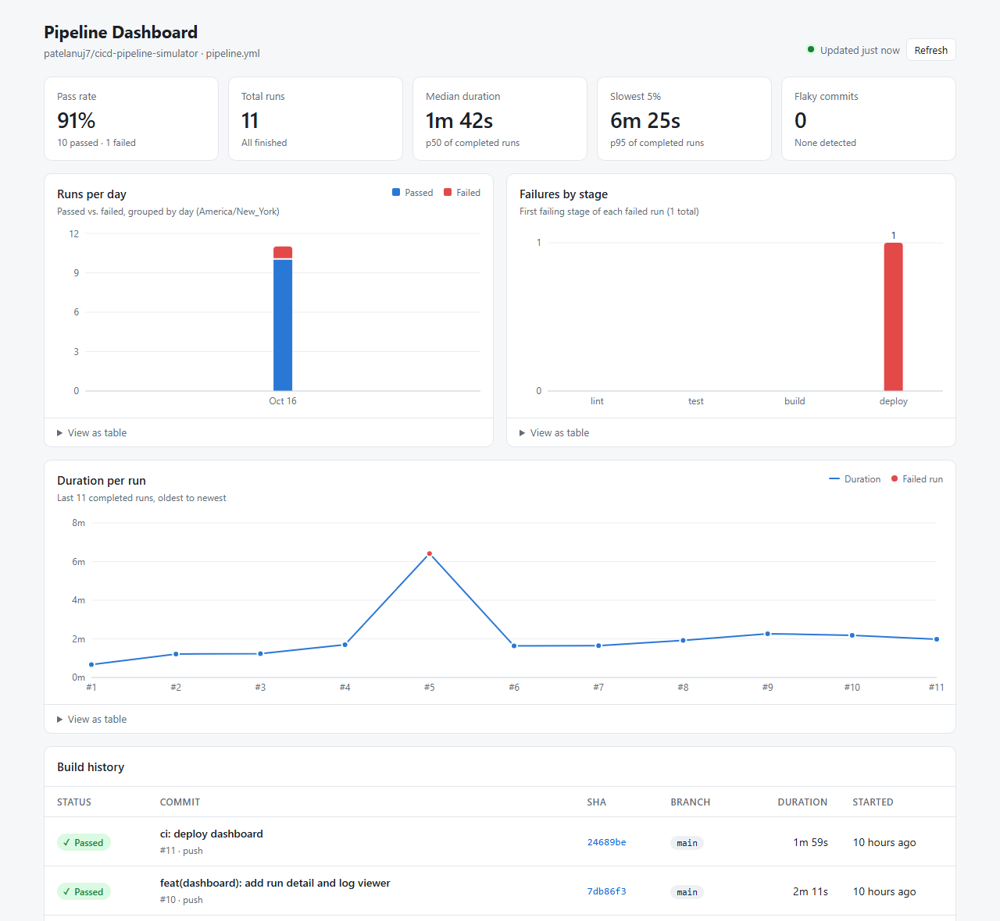
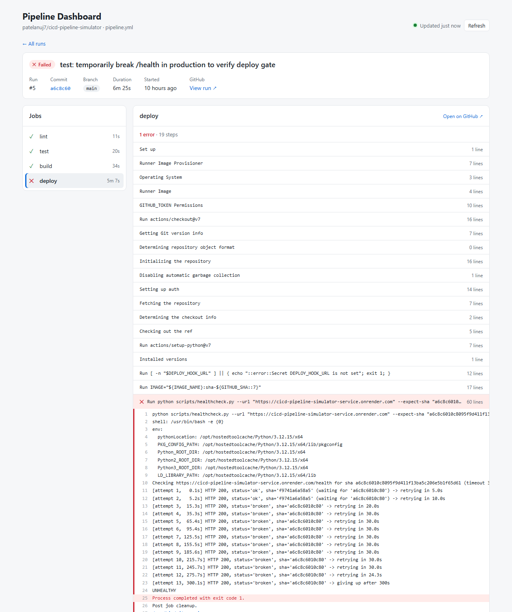
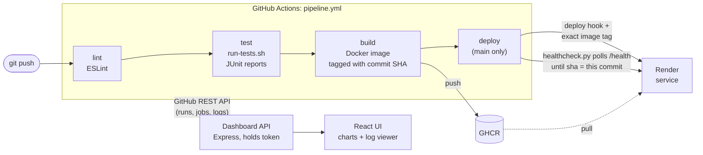

# CI/CD Pipeline Simulator

[](https://github.com/patelanuj7/cicd-pipeline-simulator/actions/workflows/pipeline.yml)

A small but real CI/CD system. Every push runs a **4-stage GitHub Actions pipeline**
(lint → test → build → deploy) that tests the code, builds a Docker image, pushes it to
GitHub Container Registry, deploys that exact image to Render, and then **proves the
deploy worked**: a Python health check polls the live service until it reports the
commit SHA that was just shipped, and fails the pipeline if it doesn't. A **React
dashboard** built on the GitHub API shows build history, pass rate, durations,
failures by stage, and step-by-step logs. Shipping a change went from
[10 manual steps to 2](docs/release-steps.md).

**Live:**
[service `/health`](https://cicd-pipeline-simulator-service.onrender.com/health) ·
[dashboard](https://cicd-pipeline-simulator.onrender.com)

> Both run on Render's free tier, which sleeps after 15 minutes idle. The first
> request after that takes about a minute; the screenshots below show what you'll see.



Opening a failed run jumps straight to the error. Here the deploy stage failed
because the new version never reported a healthy status:



---

## How it works



| Stage | What it does | Fails when |
|---|---|---|
| **lint** | `npm ci`, ESLint 10 across both workspaces | any lint error |
| **test** | [`scripts/run-tests.sh`](scripts/run-tests.sh): Vitest (service + dashboard) and pytest; JUnit XML uploaded as an artifact | any suite fails |
| **build** | Multi-stage Docker build (`node:24-alpine`, non-root, `HEALTHCHECK`), tagged `sha-<short>` and `latest`, pushed to GHCR with layer caching. PRs build but don't push | the image doesn't build |
| **deploy** | `main` only. Triggers Render with the exact `sha-` image, then [`scripts/healthcheck.py`](scripts/healthcheck.py) polls `/health` with exponential backoff | the new SHA isn't live and healthy within 5 minutes |

A few design decisions worth calling out:

- **The health check verifies the version, not just uptime.** `/health` returns
  `{ status, sha, uptimeSeconds }`, with the SHA baked into the image at build time.
  "HTTP 200" can come from the old container still serving, so the check waits for
  the new SHA specifically. I tested this by deploying a deliberately broken
  `/health`: lint, test, and build passed, and the deploy stage failed (run #5).
- **The GitHub token never reaches the browser.** The dashboard's Express backend
  calls the GitHub API with a read-only, single-repo token and serves the React app.
  It's also required anyway: the job-logs endpoint redirects to a storage URL the
  browser can't fetch cross-origin.
- **Polling is cheap.** The GitHub client sends `If-None-Match` with cached ETags;
  `304 Not Modified` replies don't count against the rate limit, so the UI refreshes
  every 20 seconds.
- **Core logic is pure and tested.** Pagination, retries, rate-limit handling,
  metrics (p50/p95, stage failures, flaky commits), and log parsing live in
  `dashboard/server/core/` with injected `fetch`, so they're unit tested without a
  network.

More detail: [`architecture.md`](architecture.md) (design and build plan) and
[`docs/release-steps.md`](docs/release-steps.md) (the 80% calculation).

## Repo layout

```
.github/workflows/pipeline.yml   the 4-stage pipeline
service/                         Express API the pipeline ships (+ Dockerfile)
scripts/run-tests.sh             runs every test suite, writes JUnit XML
scripts/healthcheck.py           post-deploy check: polls /health until the SHA matches
dashboard/server/                Express API over the GitHub API (core/ = pure logic)
dashboard/src/                   React + Vite + Recharts UI
docs/release-steps.md            manual vs. automated release, step by step
```

---

## Run it locally

### Prerequisites

- [Node.js 24](https://nodejs.org) and Git (on Windows, use Git Bash for the `.sh` script)
- [Python 3.12+](https://www.python.org/downloads/) with pytest: `python -m pip install pytest`
- [Docker Desktop](https://www.docker.com/products/docker-desktop/) (only for the image)

### 1. Install and test

```bash
git clone https://github.com/patelanuj7/cicd-pipeline-simulator.git
cd cicd-pipeline-simulator
npm install
npm run lint
npm run typecheck
bash scripts/run-tests.sh      # all suites; JUnit XML in reports/
```

### 2. Run the service

```bash
npm start -w service           # http://localhost:3000
curl http://localhost:3000/health
# {"status":"ok","sha":"dev","uptimeSeconds":3}
```

Or as the pipeline builds it, from the repo root (the build context is the root so the
image can use the root lockfile):

```bash
docker build -f service/Dockerfile -t svc --build-arg GIT_SHA=abc123 .
docker run --rm -p 3000:3000 svc
python scripts/healthcheck.py --url http://localhost:3000 --expect-sha abc123
```

### 3. Run the dashboard

The dashboard needs a GitHub token that can read Actions data for the repo you point it at.

1. Create a [fine-grained token](https://github.com/settings/personal-access-tokens/new):
   **Repository access → Only select repositories →** your repo, and
   **Repository permissions → Actions → Read-only**. Permissions default to *No access*,
   and without one the token can't see a private repo at all; GitHub answers `404`.
2. Copy `dashboard/.env.example` to `dashboard/.env` and fill it in:

   ```bash
   GITHUB_TOKEN=github_pat_...
   GITHUB_OWNER=patelanuj7
   GITHUB_REPO=cicd-pipeline-simulator
   ```

3. Start the API and the UI together:

   ```bash
   npm run dev -w dashboard       # UI at http://localhost:5173, API at :8787
   ```

For a production build: `npm run build -w dashboard && npm start -w dashboard`
(one server on :8787 serving both).

---

## Deploy your own copy

Both apps run on [Render](https://render.com)'s free tier (no credit card). Don't add
a keep-alive pinger: two always-on free services exceed Render's 750 free hours per month.

**Service** (needs one green `build` run first, so the image exists):

1. GitHub → your profile → **Packages** → `cicd-pipeline-simulator-service` →
   **Package settings** → change visibility to **Public** (so Render can pull it).
2. Render → **New → Web Service → Existing Image**:
   `ghcr.io/<you>/cicd-pipeline-simulator-service:latest`, instance **Free**,
   **Health Check Path** `/health`.
3. Copy the service's **Settings → Deploy Hook** URL (treat it like a password).
4. In the GitHub repo: **Settings → Secrets and variables → Actions**: secret
   `DEPLOY_HOOK_URL` = the hook URL; variable `SERVICE_URL` = `https://<service>.onrender.com`.

**Dashboard:**

1. Render → **New → Web Service →** connect this GitHub repo.
   **Root Directory** `dashboard`, **Build Command** `npm ci && npm run build`,
   **Start Command** `npm start`, instance **Free**, **Health Check Path** `/api/health`.
2. **Environment:** `GITHUB_TOKEN` (fine-grained, as above), `GITHUB_OWNER`, `GITHUB_REPO`.
   Never commit these.

---

## What I learned

- **"Healthy" and "deployed" are different questions.** A health check that only
  looks for HTTP 200 passes while the old container is still serving. Baking the
  commit SHA into the image and waiting for it in `/health` is what makes the deploy
  stage mean something, and deliberately breaking production proved the gate works.
- **Green/red is a bad pass/fail palette.** I ran the chart colors through a
  colorblind-safety check: green vs. red scored ΔE 4.1 under simulated deuteranopia
  (8+ is the target), so people with red-green color blindness (about 1 in 12 men)
  could barely tell a passing day from a failing one. Passed is blue in the charts for
  that reason.
- **Windows is a real CI environment to design for.** `python3` on Windows can be a
  Microsoft Store placeholder that exists on PATH but doesn't run, so the test runner
  actually runs each candidate interpreter instead of checking it exists. And
  `.gitattributes` forces LF on `.sh`/`.py` files, or Linux runners fail with
  `bad interpreter: /bin/bash^M`.
- **Node as PID 1 ignores SIGTERM.** In a container, `docker stop` waited its full
  10 seconds and then killed the process, and hosts send the same signal when they
  replace a container on redeploy. Handling the signal explicitly brought shutdown
  down to under a second.
- **Monorepos complicate Docker builds.** The lockfile lives at the workspace root,
  so the service image builds from the root with an allowlist `.dockerignore`, which
  keeps `npm ci` reproducible without copying `.git`, `.env`, or dashboard source into
  the image.
- **Least-privilege tokens fail quietly.** A fine-grained token with no permissions
  selected can't see a private repo, and GitHub reports that as `404 Not Found`
  rather than `403`. Reading the upstream status code instead of guessing saved a
  lot of time.
